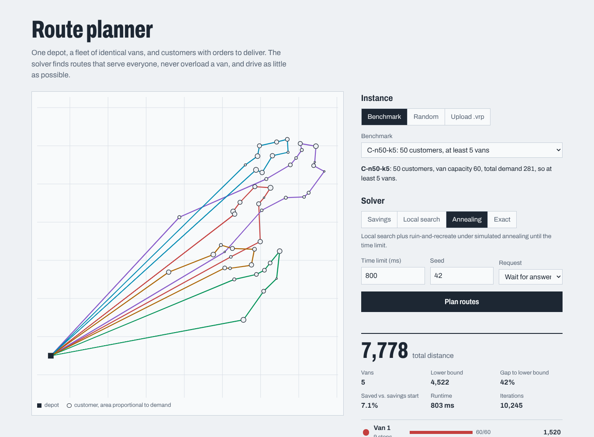

# vrp-route-service

A REST service that plans delivery routes. Given one depot, a fleet of identical vehicles of
capacity `Q`, and customers with demands, it returns routes that serve every customer once, never
overload a vehicle, and keep total driving distance low. It is the core of problems such as
shuttle booking, parcel delivery or field-service scheduling.

- **Backend:** Java 21 with **zero runtime dependencies**: the JDK `HttpServer` on virtual
  threads, records, sealed interfaces, pattern-matching `switch`, and a hand-written JSON
  parser/serializer.
- **Optimisation:** Clarke–Wright savings, local search (2-opt, relocate, swap, 2-opt*),
  simulated-annealing iterated local search with ruin and recreate, an exact subset DP for
  `n ≤ 12`, and a provable lower bound.
- **API:** synchronous solve plus asynchronous jobs, RFC 9457 problem responses, field-level
  validation, a hand-written [OpenAPI 3 spec](openapi.yaml), and a repository interface with a
  [PostgreSQL schema](db/schema.sql).
- **Frontend:** Angular 22 (standalone components, signals, strict TypeScript) that draws
  instances and routes as SVG.



## The problem

Let `V = {0, 1, …, n}` with depot `0`, distances `c_ij = c_ji ≥ 0`, demands `q_i ∈ ℕ` with
`q_i ≤ Q`, and binary variables `x_ij` (edge `{i,j}` used once) for `i < j`. With an unlimited fleet
the CVRP is the integer program (two-index formulation, Laporte–Nobert):

```
minimise    Σ_{i<j} c_ij x_ij

subject to  Σ_{j≠i} x_ij             = 2                 for every customer i            (degree; x_ij ≡ x_ji)
            Σ_{i∈S, j∉S} x_ij        ≥ 2 ⌈ q(S) / Q ⌉    for every ∅ ≠ S ⊆ {1..n}        (rounded capacity)
            x_ij ∈ {0, 1}  for 1 ≤ i < j ≤ n,   x_0j ∈ {0, 1, 2}  for j ≥ 1
```

`x_0j = 2` encodes the single-customer route `0 → j → 0`. The rounded-capacity cuts do two jobs.
They eliminate subtours, since a cycle not through the depot has 0 edges leaving it. They also force
at least `⌈q(S)/Q⌉` vehicles to enter every customer set `S`. The number of vehicles,
`½ Σ_j x_0j`, is part of the output. CVRP generalises the travelling salesman problem
(`Q ≥ Σ q_i`), so it is NP-hard. This service therefore uses heuristics with measured quality,
plus an exact method for tiny instances.

## Algorithms

| Stage | Method | Time per call | Guarantee |
|---|---|---|---|
| Construction | Clarke–Wright parallel savings | `O(n² log n)` | feasible |
| Improvement | First-improvement local search: 2-opt, relocate (incl. to a new route), swap, 2-opt*; granular (20 nearest neighbours) | `O(20 n)` per sweep, each move `O(1)` to evaluate | local optimum for all four neighbourhoods |
| Metaheuristic | Iterated local search: radial ruin plus cheapest-insertion recreate, Metropolis acceptance, geometric cooling in elapsed budget | until time limit or iteration cap | best-so-far returned; reproducible with a seed and an iteration cap |
| Exact | Held–Karp `tsp(S)` for each subset, then set-partition DP fixing the lowest customer | `O(2ⁿ n² + 3ⁿ)` | optimal, `n ≤ 12` |
| Bound | `MST + Σ_{k≤K} e_k`, `K = ⌈Σq/Q⌉` | `O(n²)` | valid lower bound (proof in the docs) |

[`docs/algorithms.md`](docs/algorithms.md) explains each neighbourhood move, its delta formula and
feasibility test, the acceptance rule and cooling schedule, and proves the lower bound.

## Benchmarks

The numbers below were produced by `./build.sh bench 2000 5` on the development container
(2 vCPUs, OpenJDK 21.0.12, one solver thread per run). The five bundled instances were
**generated by this project** (`InstanceGenerator`, seeds in the file headers). They are *not*
CVRPLIB instances, so no published optimum exists for them. The `U` instances have uniformly
scattered customers and the depot in the centre. The `C` instances have clustered customers and
the depot in a corner. `K_min = ⌈Σq/Q⌉`.

| instance | n | K_min | lower bound | savings | + local search | annealing best | annealing mean | vehicles | iterations/run | optimum (DP) |
|---|---:|---:|---:|---:|---:|---:|---:|---:|---:|---:|
| U-n10-k3 | 10 | 3 | 1940 | 3223 | 3223 | 3223 | 3223.0 | 3 | 285785 | 3223 |
| U-n30-k4 | 30 | 4 | 4354 | 6598 | 6543 | 6346 | 6346.0 | 4 | 77166 | n/a |
| C-n50-k5 | 50 | 5 | 4522 | 8376 | 8010 | 7773 | 7774.0 | 5 | 36185 | n/a |
| U-n100-k8 | 100 | 8 | 7822 | 12277 | 12182 | 11313 | 11313.0 | 8 | 10758 | n/a |
| C-n200-k12 | 200 | 12 | 11771 | 21947 | 21491 | 20673 | 20757.6 | 12 | 3570 | n/a |

"Annealing" is 2 s per run with seeds 1–5. On U-n10-k3 savings is already optimal. On the four
larger instances annealing is 3.8–7.9% better than savings, and the mean over the five seeds is
within 0.41% of the best seed. The lower bound column shows that the MST bound is
weak: 31–43% below the best solution. Real optimality gaps therefore come from the exact solver.

**Gaps against the proven optimum.** For each `n`, 30 random instances (half uniform, half
clustered, about 3 customers per vehicle) were solved exactly and by each heuristic.
Annealing was capped at 200 iterations.

| n | instances | savings mean gap | savings max gap | LS mean gap | LS max gap | annealing (200 it) optimal | annealing max gap | exact DP mean time |
|---:|---:|---:|---:|---:|---:|---:|---:|---:|
| 6 | 30 | 3.60% | 35.71% | 3.14% | 35.71% | 30/30 | 0.00% | 0.13 ms |
| 8 | 30 | 4.38% | 31.01% | 4.30% | 31.01% | 30/30 | 0.00% | 0.26 ms |
| 10 | 30 | 4.50% | 27.65% | 4.28% | 27.65% | 30/30 | 0.00% | 0.67 ms |
| 12 | 30 | 7.44% | 24.80% | 6.92% | 24.80% | 29/30 | 0.47% | 3.01 ms |

Reading of the table: the large worst cases of savings and local search are instances where
the greedy merge order puts the wrong customers in the same vehicle. No single move of the four
neighbourhoods can repair that grouping without first making the solution worse. Ruin and recreate
exists for exactly this case. With it, 119 of 120 tiny instances are solved to optimality. These
are small instances, and they say nothing about large-instance quality beyond the trend in the first
table.

Reproduce with `./build.sh bench [timeLimitMs] [seeds]`. Times depend on the machine.

## Architecture

```
          ┌──────────── Angular 22 (frontend/) ─────────────┐
          │ App (signals) ─ RouteMap (SVG) ─ VrpApi (HTTP)  │
          └──────────────────────┬──────────────────────────┘
                                 │ /api (dev proxy → :8080)
┌────────────────────────────────▼────────────────────────────────────────┐
│ api/       HttpServerAdapter  transport: virtual threads, CORS,         │
│                               size limit, content type, access log      │
│            RouteApi + Router  pure handlers: Request → Response         │
│            ApiCodec           JSON ⇄ domain, collects all field errors  │
│ jobs/      JobService         async solves on virtual threads,          │
│                               Semaphore caps concurrent async jobs      │
│            JobRepository ◄─── InMemoryJobRepository (PostgreSQL: see db)│
│ solver/    CvrpSolver → ClarkeWright, LocalSearch, SimulatedAnnealing,  │
│                         RuinRecreate, ExactSolver, LowerBound           │
│            SolutionChecker   independent feasibility oracle             │
│ io/        TsplibReader (CVRPLIB .vrp), InstanceGenerator, Catalog      │
│ json/      sealed JsonValue tree, strict RFC 8259 parser/writer         │
│ model/     immutable records: Instance, Customer, Point, Solution       │
└─────────────────────────────────────────────────────────────────────────┘
```

Design decisions:

- **Handlers are pure functions.** `RouteApi.dispatch(method, path, query, body)` returns a
  `Response`, so the API is unit-tested without sockets (`RouteApiTest`). A separate test covers
  the real HTTP layer on an ephemeral port (`HttpServerAdapterTest`).
- **Validation collects every error.** A bad request returns `422` with a list such as
  `instance.customers[3].demand: demand 12 exceeds vehicle capacity 10`. Unknown fields are
  rejected, which catches typos. The status codes are: malformed JSON `400`, wrong
  `Content-Type` `415`, body over 2 MiB `413`, wrong method `405` with an `Allow` header.
- **Virtual threads with a concurrency cap.** Each request and each job gets a virtual thread,
  which is cheap. The solver is CPU-bound, so a fair `Semaphore` (default: number of cores)
  limits how many jobs compute at once. The rest wait as `QUEUED` without holding OS threads.
  The cap covers only asynchronous jobs (`POST /api/jobs`). A synchronous `POST /api/solve` runs
  the solver directly on its request thread and does not take a permit, so concurrent synchronous
  requests are limited only by their own time limits.
- **Persistence behind an interface.** `JobRepository` is a port. No JDBC driver could be
  downloaded in the development environment, so only the in-memory adapter exists.
  [`db/schema.sql`](db/schema.sql) contains the PostgreSQL table with the job state machine as
  `CHECK` constraints, and the indexes for the actual queries: newest-first listing, a partial
  index on active jobs, and best cost per instance. It also lists the parameterised statements a
  `JdbcJobRepository` would run, including the `FOR UPDATE SKIP LOCKED` claim for several worker
  instances.
- **Results are checked before they leave the service.** Every solution, synchronous or from a
  job, is passed through `SolutionChecker`, which recomputes loads and costs from the instance.
- **Dense internal model.** `Problem` maps customers to indices `1..n` and precomputes the full
  distance matrix (32 MB at the 2 000-customer limit). Move evaluation is then array lookups only.
  External ids are restored only in the output.

## Running it

Requirements: JDK 21. For the frontend: Node `^22.22.3`, `^24.15` or `≥ 26`, as required by
Angular CLI 22.

```bash
# Backend: build, test, run (no Maven needed)
./build.sh            # compile + 43 tests (JUnit shim runner, see below)
./build.sh run        # http://127.0.0.1:8080  (env: PORT, BIND, MAX_CONCURRENT_JOBS)
./build.sh jar && java -jar out/vrp-route-service.jar
./build.sh bench 2000 5

# Backend with Maven (needs Maven Central)
mvn verify
mvn exec:java

# Frontend: dev server on :4200, proxies /api to :8080
cd frontend
npm ci
npm start
npm run build
npm test              # Vitest + jsdom, no browser required
```

### API examples

```bash
curl -s localhost:8080/api/health
# {"status":"UP","instances":5,"jobs":{"queued":0,"running":0,"succeeded":0,"failed":0}}

curl -s -X POST localhost:8080/api/solve -H 'Content-Type: application/json' -d '{
  "instance": {"name": "tiny", "capacity": 10, "depot": {"x": 0, "y": 0},
    "customers": [{"id": 1, "x": 3, "y": 4, "demand": 4},
                  {"id": 2, "x": -3, "y": 4, "demand": 5},
                  {"id": 3, "x": 0, "y": -5, "demand": 6}]},
  "options": {"algorithm": "exact"}}'
# {"instance":"tiny","algorithm":"exact","cost":26,"vehicles":2,"lowerBound":26,"gapToLowerBound":0,
#  "initialCost":26,"optimal":true,"runtimeMs":7,"iterations":0,
#  "routes":[{"customers":[2,1],"load":9,"cost":16},{"customers":[3],"load":6,"cost":10}]}

curl -s -X POST localhost:8080/api/solve -H 'Content-Type: application/json' \
  -d '{"instanceName": "C-n50-k5", "options": {"algorithm": "annealing", "timeLimitMs": 1000, "seed": 7}}'
# {"instance":"C-n50-k5","algorithm":"annealing","cost":7773,"vehicles":5,"lowerBound":4522, ...}

# Asynchronous: 202 Accepted + Location header, then poll
curl -si -X POST localhost:8080/api/jobs -H 'Content-Type: application/json' \
  -d '{"instanceName": "U-n100-k8", "options": {"timeLimitMs": 1500}}'
# HTTP/1.1 202 Accepted
# Location: /api/jobs/18c0b2ef-6b7a-4816-8634-00d6c48876a4
curl -s localhost:8080/api/jobs/18c0b2ef-6b7a-4816-8634-00d6c48876a4
# {"id":"18c0…","status":"SUCCEEDED", ..., "cost":11313,"result":{...}}

# A CVRPLIB file can be sent as text
jq -Rs '{tsplib: ., options: {algorithm: "local-search"}}' my-instance.vrp \
  | curl -s -X POST localhost:8080/api/solve -H 'Content-Type: application/json' --data-binary @-

# Validation errors list every field
curl -s -X POST localhost:8080/api/solve -H 'Content-Type: application/json' \
  -d '{"instance":{"capacity":5,"depot":{"x":0},"customers":[{"x":1,"y":1,"demand":9}]},"options":{"algorithm":"magic"}}'
# 422 {"title":"Validation Failed","status":422,"detail":"2 validation errors","errors":[
#   {"field":"instance.depot.y","message":"is required"},
#   {"field":"options.algorithm","message":"must be one of [savings, local-search, annealing, exact]"}]}
```

## Testing

- **43 backend tests** in 8 classes. They include property-based tests on 145 random instances:
  every algorithm must return a feasible solution, and costs must satisfy
  `LB ≤ exact ≤ annealing ≤ local search ≤ savings`. The step `annealing ≤ local search` is not
  a property of annealing in general: it holds here because, for the same seed, annealing first
  runs the identical local search on the savings solution and then returns the best solution it
  has seen. The exact DP is checked against an independent brute force (all permutations plus the split DP). Other tests cover the JSON
  round trip on 500 random trees, TSPLIB parsing with line-numbered errors, every HTTP error
  path, concurrent requests over a real socket, and the async job lifecycle.
- **6 frontend tests** (Vitest + jsdom): the TSPLIB parser, the route-colour spacing, SVG
  rendering of routes, the full load → solve → render flow against a mocked backend, and display
  of a `422` field list.

**How the backend tests run without JUnit.** The development environment could not reach
Maven Central. The tests are therefore written against the standard JUnit 5 API
(`org.junit.jupiter.api.Test`, `Assertions.*`, `@BeforeEach`/`@AfterEach`), and
`tools/junit-shim/` contains a minimal re-implementation of exactly those annotations and
assertions, plus a reflective runner. `build.sh` compiles against the shim; `pom.xml` uses real
JUnit 5 and never sees the shim. CI runs both.

## Limitations and honest notes

- **Not verified in the development sandbox:** `mvn verify` (Maven could not download plugins
  or JUnit) and the GitHub Actions workflow. The same sources compile with `javac --release 21
  -Xlint:all -Werror`, and all 43 tests pass under the shim runner.
- No PostgreSQL adapter is implemented, only the schema and the queries. Jobs are lost on restart.
- Single depot, homogeneous fleet, Euclidean distances. There are no time windows, no maximum
  route length or duration, and no road network. A real deployment would take a distance matrix
  from a routing engine such as OSRM; the solver only needs `d(i,j)`.
- The lower bound is weak. For tight gaps on large instances one would solve an LP relaxation with
  capacity cuts, or compare with state-of-the-art codes (HGS-CVRP, LKH-3) on CVRPLIB.
- With only a time limit (no `maxIterations`) results depend on machine speed.
- The HTTP layer is the JDK's built-in server. It is fine for a demo and internal tools; a
  production service would use Spring Boot, Quarkus or Helidon for TLS, metrics and auth.

## How AI tools were used

This project was developed with AI assistance (Claude, by Anthropic) for code generation,
tests and documentation. The author reviewed it. The algorithms, correctness arguments and
benchmark numbers were checked by running the code; every number in this README comes from an
actual run.

## License

[MIT](LICENSE) © 2026 Urban Ogrinec
